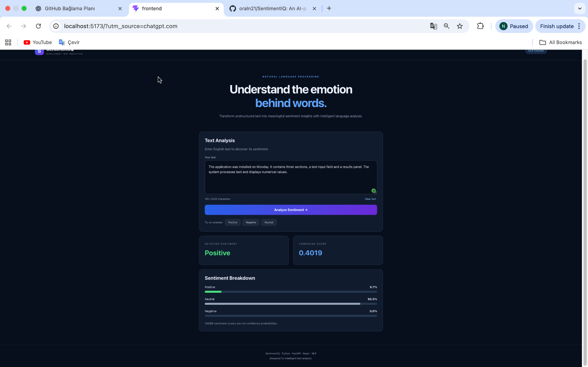
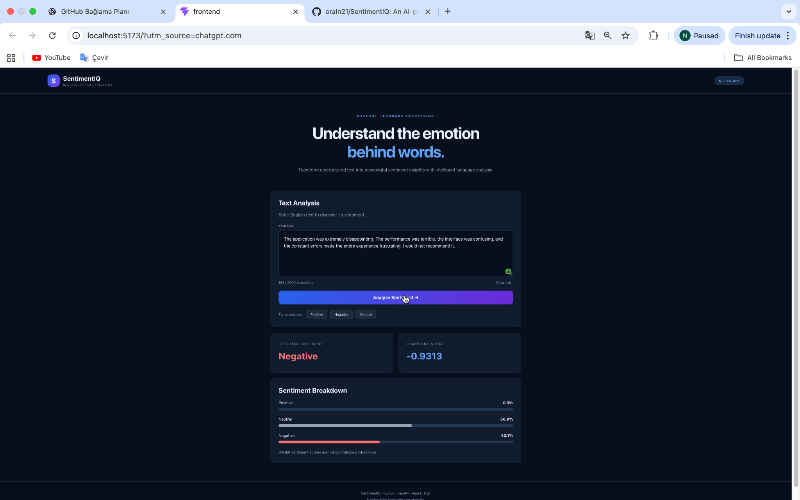
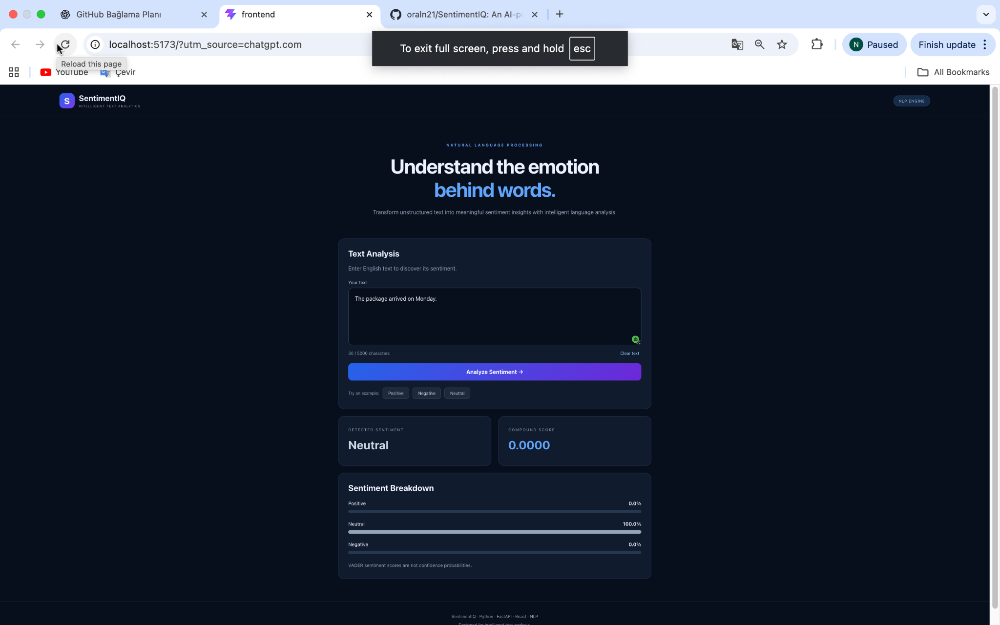
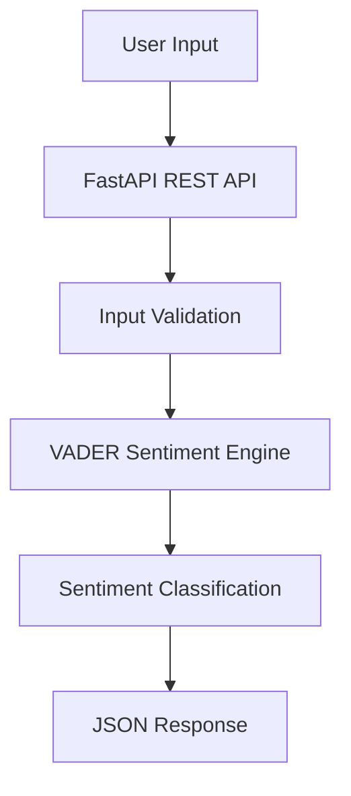

<h1 align="center">🧠 SentimentIQ</h1>

<h3 align="center">
Intelligent Sentiment Analysis Platform
</h3>

<p align="center">
Transforming text into meaningful insights.
</p>

<p align="center">
  
  
  
  
</p>

---

## Overview

SentimentIQ is a natural language processing platform designed to analyse English text and classify sentiment as positive, negative or neutral.

The project combines sentiment analysis, REST API development and automated software testing to demonstrate practical software engineering and artificial intelligence concepts.

---

## Application Demo

SentimentIQ provides an interactive dashboard for real-time
sentiment analysis, combining a modern React interface
with a Python FastAPI backend.

### Positive Sentiment Analysis

The application identifies positive emotions in English text
and displays the compound sentiment score and sentiment breakdown.



### Negative Sentiment Analysis

Negative text is classified using the VADER NLP engine,
with visual indicators representing the sentiment scores.



### Neutral Sentiment Analysis

Neutral statements are analysed and classified based on
their compound sentiment score.



### Dashboard Features

- Real-time sentiment analysis
- Interactive text input
- Positive, negative and neutral classification
- Visual sentiment breakdown
- Compound sentiment scoring
- Character counter and input validation
- Responsive dark-themed interface
- Frontend and backend API integration

---


## Current Features

- English text sentiment analysis
- Positive, negative and neutral classification
- Compound sentiment scoring
- RESTful API using FastAPI
- Interactive Swagger API documentation
- Input validation and error handling
- Automated unit and API testing

## Technology Stack

<p>
  
</p>

| Technology | Purpose |
| --- | --- |
| Python | Core programming language |
| VADER | Rule-based sentiment analysis |
| FastAPI | REST API development |
| Uvicorn | Application server |
| Pytest | Automated testing |
| HTTPX | API testing |

## System Architecture



## Project Structure

```text
SentimentIQ/
├── backend/
│   ├── __init__.py
│   ├── main.py
│   └── sentiment.py
├── tests/
│   └── test_sentiment.py
├── requirements.txt
├── .gitignore
├── LICENSE
└── README.md
```

## Installation

Clone the repository:

```bash
git clone https://github.com/oraln21/SentimentIQ.git
cd SentimentIQ
```

Create a virtual environment:

```bash
python3 -m venv .venv
source .venv/bin/activate
```

Install the dependencies:

```bash
python -m pip install -r requirements.txt
```

## Running the Application

```bash
python -m uvicorn backend.main:app --reload --port 8001
```

Open the interactive API documentation:

http://127.0.0.1:8001/docs

## API Endpoints

| Method | Endpoint | Description |
| --- | --- | --- |
| GET | / | Application information |
| GET | /health | Health check |
| POST | /analyze | Analyse text sentiment |

### Example Request

```json
{
  "text": "I absolutely love this product!"
}
```

### Example Response

```json
{
  "text": "I absolutely love this product!",
  "sentiment": "Positive",
  "scores": {
    "positive": 0.545,
    "neutral": 0.455,
    "negative": 0.0,
    "compound": 0.6989
  }
}
```

## Automated Testing

Run the test suite:

```bash
python -m pytest -v
```

Initial local test results:

- 10 tests passed
- 0 tests failed
- 1 dependency deprecation warning

## Limitations

- Currently designed for English text.
- VADER uses a rule-based approach.
- Sentiment scores are not calibrated confidence probabilities.
- Sarcasm and complex contextual meaning may reduce accuracy.

## Development Roadmap

- [x] Project architecture
- [x] Sentiment analysis engine
- [x] FastAPI backend
- [x] Input validation
- [x] Automated testing
- [ ] Machine learning model training
- [ ] Model performance evaluation
- [ ] React frontend
- [ ] Data visualisation dashboard
- [ ] GitHub Actions CI/CD
- [ ] Application deployment

## Author

**Nilay Oral**

Software Engineering Student | AI & Machine Learning

[GitHub Profile](https://github.com/oraln21)

## License

This project is licensed under the MIT License.

---

<p align="center">
  Built with curiosity, code and continuous learning.
</p>
