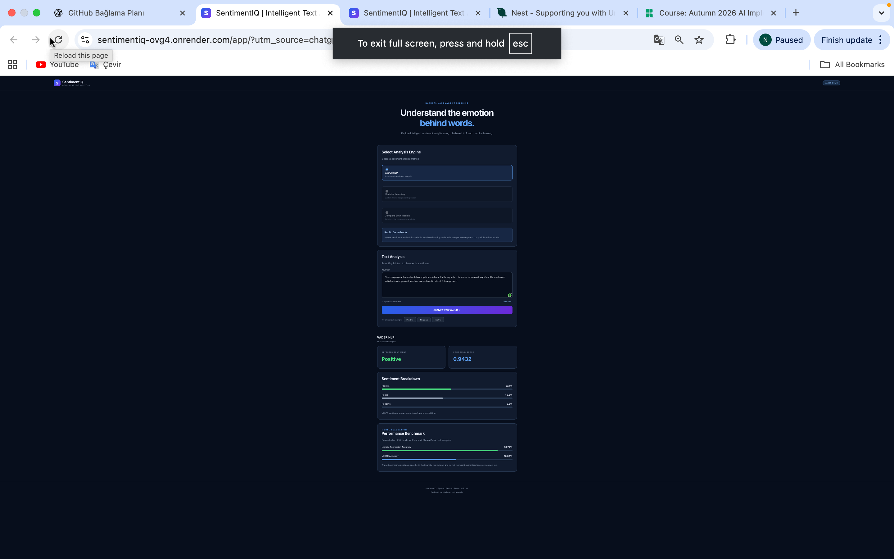
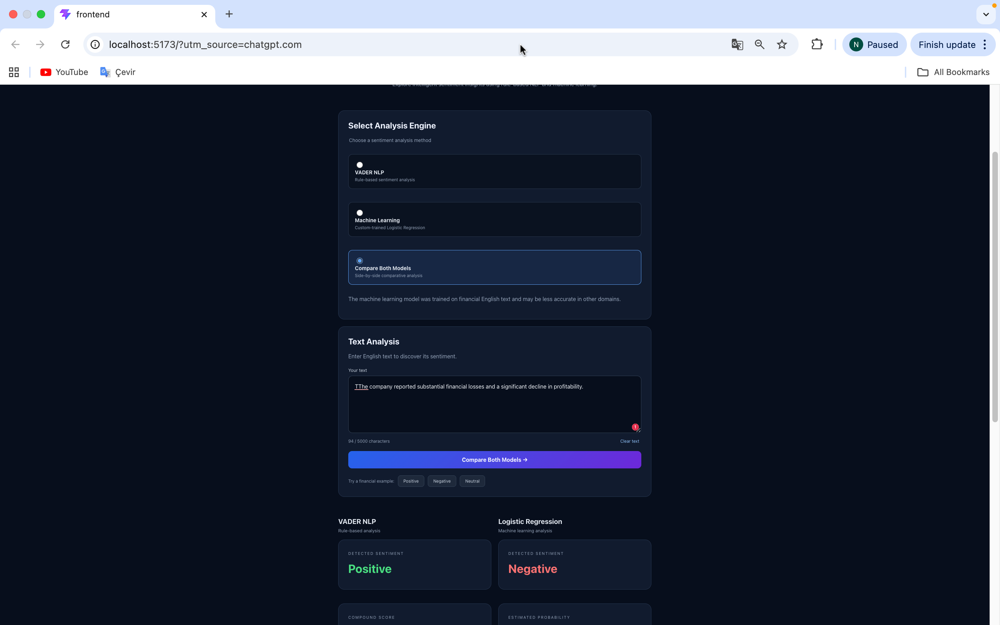
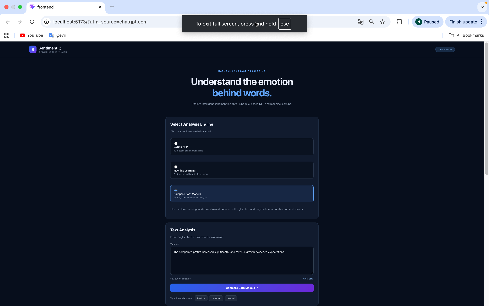
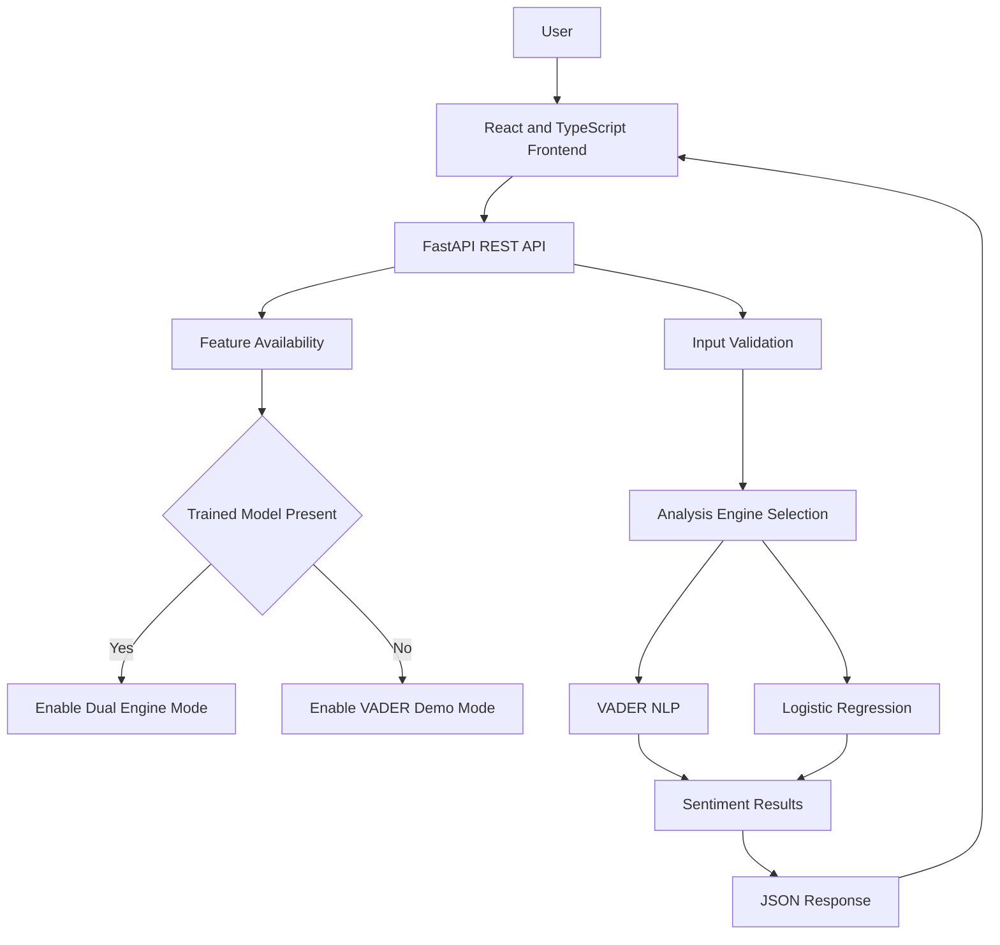
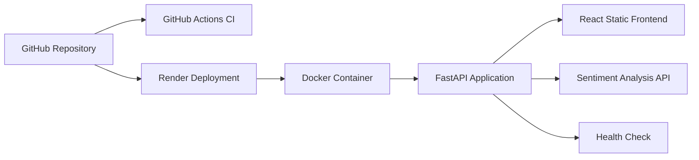
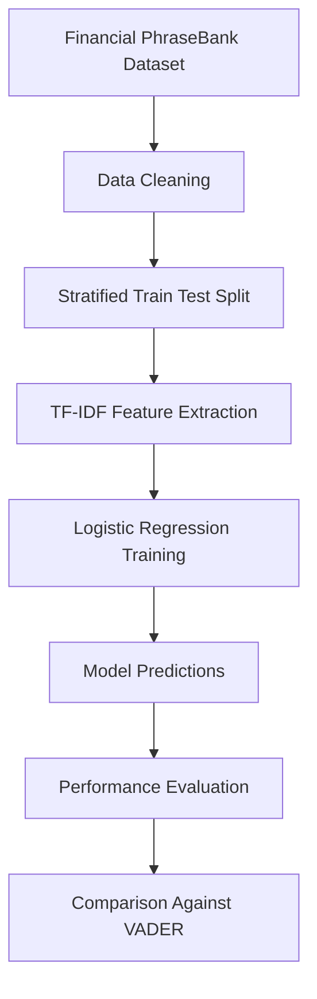
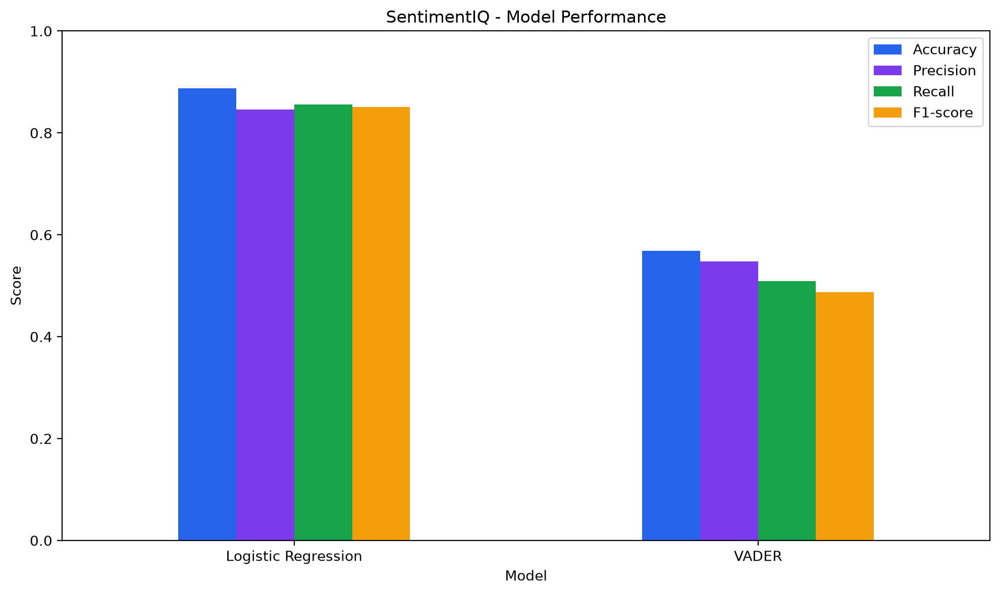
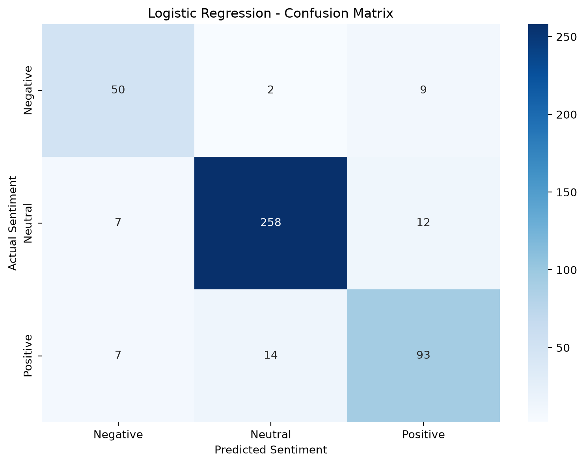

<div align="center">

# SentimentIQ

### Intelligent Sentiment Analysis Platform

Transforming text into meaningful insights through natural language processing and machine learning.

[](https://github.com/oraln21/SentimentIQ/actions/workflows/ci.yml)


[](https://sentimentiq-ovg4.onrender.com/app/)

**38 Automated Tests | 88.72% Local ML Benchmark Accuracy | Cloud Deployed**

[Live Application](https://sentimentiq-ovg4.onrender.com/app/) ·
[API Documentation](https://sentimentiq-ovg4.onrender.com/docs) ·
[Architecture](docs/architecture.md)

</div>

---

## Overview

SentimentIQ is a full-stack sentiment analysis platform that
classifies English text as positive, negative or neutral using
natural language processing and supervised machine learning.

The project combines a responsive React and TypeScript frontend,
a FastAPI backend, the VADER rule-based sentiment engine and a
custom-trained Logistic Regression model.

SentimentIQ demonstrates an end-to-end software engineering
workflow, from data preparation and model evaluation to API
development, automated testing, containerisation, continuous
integration and cloud deployment.

## Live Demo

**Application:** https://sentimentiq-ovg4.onrender.com/app/

**Interactive API:** https://sentimentiq-ovg4.onrender.com/docs

The public demonstration is hosted on Render using a
containerised production environment.

### Deployment Modes

| Feature | Public Demo | Full Local Version |
| --- | --- | --- |
| VADER sentiment analysis | Available | Available |
| Machine learning analysis | Unavailable | Available with trained model |
| Side-by-side comparison | Unavailable | Available with trained model |
| Interactive visualisations | Available | Available |
| Performance benchmark | Available | Available |
| Responsive interface | Available | Available |
| REST API documentation | Available | Available |

The application automatically detects whether the trained
machine learning model is present and adjusts the available
analysis engines accordingly.

The public demo uses VADER. The dataset and trained model
are not distributed pending verification of their licensing
and distribution conditions.

> The free hosting instance may enter sleep mode after inactivity.
> The first request may therefore take longer to complete.

---

## Application Showcase
### Live Public Demo

The publicly deployed version supports VADER sentiment
analysis with interactive visualisations and automatic
feature availability detection.



[Launch the Live Application](https://sentimentiq-ovg4.onrender.com/app/)

### Full Local Version

The following screenshots demonstrate the full local
dual-engine version of SentimentIQ.

### Positive Sentiment Analysis



### Negative Sentiment Analysis



### Neutral Sentiment Analysis


The dashboard enables users to examine sentiment classifications,
compare model predictions, visualise sentiment scores and
identify agreement or disagreement between analysis engines.

---

## Key Features

### Natural Language Processing

- English-language sentiment classification.
- Positive, negative and neutral sentiment detection.
- VADER compound sentiment scoring.
- Interactive sentiment score breakdown.

### Machine Learning

- Custom-trained supervised classification model.
- TF-IDF feature extraction.
- Logistic Regression classification.
- Estimated class probabilities.
- Side-by-side model comparison.
- Model agreement and disagreement detection.
- Reproducible evaluation pipeline.

### Full-Stack Engineering

- Responsive React and TypeScript interface.
- FastAPI REST API.
- Interactive Swagger documentation.
- Input validation and structured error handling.
- Maximum input length of 5,000 characters.
- Predefined examples and interactive text analysis.
- Dynamic feature availability detection.
- Graceful handling of unavailable ML functionality.

### DevOps and Quality Assurance

- Automated backend and browser testing.
- GitHub Actions continuous integration.
- Multi-stage Docker build.
- Non-root container execution.
- Container health monitoring.
- Cloud deployment on Render.

---

## Technology Stack

<p align="center">
  
</p>

| Category | Technologies |
| --- | --- |
| Frontend | React, TypeScript, Vite, CSS |
| Backend | Python 3.13, FastAPI, Uvicorn |
| NLP | VADER Sentiment |
| Machine Learning | Scikit-learn, TF-IDF, Logistic Regression |
| Model Persistence | Joblib |
| Data Processing | Pandas, NumPy |
| Backend Testing | Pytest, HTTPX |
| Browser Testing | Playwright |
| Code Quality | ESLint, TypeScript |
| Containerisation | Docker |
| Continuous Integration | GitHub Actions |
| Cloud Hosting | Render |
| Version Control | Git and GitHub |

---

## System Architecture

SentimentIQ uses a layered architecture that separates
the user interface, API, sentiment analysis engines
and model evaluation components.



For a detailed explanation of the architecture,
machine learning pipeline and testing strategy,
see the [System Architecture Documentation](docs/architecture.md).

### Production Architecture



---

## Machine Learning Pipeline

The custom machine learning model uses supervised learning
to classify financial English text.

### Dataset

| Property | Value |
| --- | --- |
| Dataset | Financial PhraseBank |
| Dataset subset | sentences_allagree |
| Cleaned records | 2,259 |
| Training samples | 1,807 |
| Testing samples | 452 |
| Train/test split | 80/20 |
| Random seed | 42 |
| Classification | Positive, Negative, Neutral |

### Training Workflow



### Model Performance

Both sentiment analysis approaches were evaluated using
the same held-out financial test dataset.

| Metric | Logistic Regression | VADER |
| --- | ---: | ---: |
| Accuracy | **88.72%** | 56.86% |
| Macro Precision | **84.62%** | 54.79% |
| Macro Recall | **85.56%** | 50.92% |
| Macro F1-score | **85.08%** | 48.74% |

The custom-trained model achieved an accuracy improvement
of 31.86 percentage points over the VADER baseline
on this specific test dataset.

These results do not guarantee equivalent performance
on unseen text from other domains.

### Performance Comparison



### Logistic Regression Confusion Matrix



### VADER Confusion Matrix


### Reproducing the Experiment

After obtaining the dataset independently and preparing it
in accordance with its applicable licensing conditions,
run the following commands:

```bash
python ml/prepare_data.py
python ml/train_model.py
python -m ml.evaluate_model
```

The trained model is expected at:

```text
models/sentiment_model.joblib
```

Only load trusted, compatible model files.

---

## Project Structure

```text
SentimentIQ/
├── .github/
│   └── workflows/
│       └── ci.yml
├── backend/
│   ├── __init__.py
│   ├── main.py
│   ├── sentiment.py
│   └── ml_sentiment.py
├── frontend/
│   ├── e2e/
│   │   └── sentiment.spec.ts
│   ├── public/
│   ├── src/
│   │   ├── App.tsx
│   │   └── App.css
│   ├── index.html
│   ├── package.json
│   └── vite.config.ts
├── ml/
│   ├── prepare_data.py
│   ├── train_model.py
│   └── evaluate_model.py
├── tests/
│   ├── test_sentiment.py
│   ├── test_ml_sentiment.py
│   └── test_features.py
├── docs/
│   ├── images/
│   ├── evaluation/
│   └── architecture.md
├── .dockerignore
├── .gitignore
├── Dockerfile
├── requirements.txt
├── LICENSE
└── README.md
```

The local dataset and model directories are excluded
from public distribution.

---

## API Documentation

### Available Endpoints

| Method | Endpoint | Description |
| --- | --- | --- |
| GET | `/` | Application information |
| GET | `/health` | Application health status |
| GET | `/features` | Available analysis engines |
| GET | `/api/features` | Production feature availability |
| POST | `/analyze` | VADER sentiment analysis |
| POST | `/analyze/ml` | Machine learning analysis |
| POST | `/analyze/compare` | Compare both analysis engines |
| POST | `/api/analyze` | Production VADER endpoint |
| POST | `/api/analyze/ml` | Production ML endpoint |
| POST | `/api/analyze/compare` | Production comparison endpoint |
| GET | `/docs` | Interactive Swagger documentation |
| GET | `/app/` | Production frontend dashboard |

### Example API Request

```bash
curl -X POST \
  https://sentimentiq-ovg4.onrender.com/api/analyze \
  -H "Content-Type: application/json" \
  -d '{"text":"I absolutely love this product!"}'
```

### Illustrative API Response

```json
{
  "text": "I absolutely love this product!",
  "sentiment": "Positive",
  "scores": {
    "positive": 0.545,
    "neutral": 0.455,
    "negative": 0.0,
    "compound": 0.6989
  }
}
```

### Feature Availability Response

The public deployment returns the following
feature availability configuration:

```json
{
  "vader": true,
  "machine_learning": false,
  "comparison": false
}
```

When a compatible trained model is installed locally,
the machine learning and comparison features are enabled.

Requests to unavailable ML endpoints return
a controlled HTTP 503 response.

---

## Local Installation

### Prerequisites

- Python 3.13
- Node.js and npm
- Git
- Docker Desktop (optional)

### Clone the Repository

```bash
git clone https://github.com/oraln21/SentimentIQ.git
cd SentimentIQ
```

### Configure the Backend

```bash
python3 -m venv .venv
source .venv/bin/activate
python -m pip install -r requirements.txt
```

Start the backend development server:

```bash
python -m uvicorn backend.main:app --reload --port 8001
```

API documentation:

http://127.0.0.1:8001/docs

### Configure the Frontend

Open a separate terminal:

```bash
cd frontend
npm ci
npm run dev
```

Open the development URL displayed by Vite.

### Production Frontend Build

```bash
npm run lint
npm run build
```

---

## Docker Deployment

SentimentIQ supports multi-stage containerised deployment
that combines the React frontend and FastAPI backend
into a single production image.

### Build the Image

From the repository root:

```bash
docker build -t sentimentiq:1.0.0 .
```

### Run Public Demo Mode

```bash
docker run -d \
  --name sentimentiq-demo \
  -p 127.0.0.1:8003:8000 \
  sentimentiq:1.0.0
```

Open:

- Application: http://localhost:8003/app/
- API documentation: http://localhost:8003/docs
- Health check: http://localhost:8003/health
- Available features: http://localhost:8003/api/features

### Run Full Local ML Mode

If a compatible, trusted trained model is available
in the local models directory:

```bash
docker run -d \
  --name sentimentiq-ml \
  -p 127.0.0.1:8005:8000 \
  -v "$(pwd)/models:/app/models:ro" \
  sentimentiq:1.0.0
```

Open:

http://localhost:8005/app/

### Deployment Characteristics

- Multi-stage Docker build.
- Single-server frontend and backend integration.
- Non-root application user.
- Automated container health checks.
- Pinned core machine learning dependencies.
- Read-only local model mounting.
- Graceful handling of unavailable model functionality.

---

## Automated Testing and Quality Assurance

SentimentIQ includes automated testing across
the backend API and frontend browser interface.

### Backend Testing

Run from the repository root:

```bash
python -m pytest -q
```

Backend coverage includes:

- Sentiment classification.
- Input validation.
- API responses.
- Machine learning functionality.
- Feature availability.
- Missing-model scenarios.
- Route consistency.

### Frontend Testing

```bash
cd frontend
npm ci
npx playwright install chromium
npx playwright test
```

Frontend test scenarios include:

- Application rendering.
- Analysis engine selection.
- Positive, negative and neutral results.
- Model agreement and disagreement.
- Input validation.
- Error handling.
- Mobile viewport behaviour.
- Dynamic feature availability.
- Public Demo Mode.
- Feature API failure fallback.

### Latest Recorded Local Test Results

| Test Suite | Passed | Failed |
| --- | ---: | ---: |
| Backend Pytest | 23 | 0 |
| Frontend Playwright | 15 | 0 |
| **Total** | **38** | **0** |

Browser tests use mocked API responses for controlled
and reproducible frontend validation.

Local Docker integration testing was also performed
with and without the trained machine learning model.

### Continuous Integration

GitHub Actions provides automated validation
of the backend and frontend test suites.

[View GitHub Actions Workflows](https://github.com/oraln21/SentimentIQ/actions)

---

## Cloud Deployment

SentimentIQ is deployed as a containerised web service
on Render.

| Configuration | Value |
| --- | --- |
| Cloud provider | Render |
| Runtime | Docker |
| Deployment branch | main |
| Region | Frankfurt, EU Central |
| Hosting tier | Free |
| Health check | `/health` |
| Public mode | VADER |
| Initial deployment | 26 November 2026 |

### Production Links

- [Live Application](https://sentimentiq-ovg4.onrender.com/app/)
- [API Documentation](https://sentimentiq-ovg4.onrender.com/docs)
- [Health Check](https://sentimentiq-ovg4.onrender.com/health)
- [Feature Availability](https://sentimentiq-ovg4.onrender.com/api/features)

---

## Research and Application Limitations

- The application currently supports English text.
- The custom ML model was trained on financial text.
- Benchmark results may not generalise to other domains.
- Sarcasm and complex contextual meaning may reduce accuracy.
- VADER sentiment scores are not confidence probabilities.
- ML class probabilities are not guarantees of correctness.
- Further independent cross-domain evaluation is required.
- The public demonstration does not include the trained ML model.
- Free cloud hosting may introduce cold-start delays.
- The application is a portfolio demonstration, not a
  production-scale enterprise sentiment analysis service.

---

## Development Roadmap

### Completed

- [x] Project architecture
- [x] VADER sentiment analysis engine
- [x] FastAPI backend
- [x] Input validation and error handling
- [x] Dataset preparation
- [x] Custom machine learning model training
- [x] Model performance evaluation
- [x] React and TypeScript frontend
- [x] Dual-engine integration
- [x] Interactive model comparison dashboard
- [x] Automated backend testing
- [x] Playwright browser testing
- [x] GitHub Actions continuous integration
- [x] Docker containerisation
- [x] Dynamic Public Demo Mode
- [x] Cloud deployment
- [x] Public live demonstration

### Future Improvements

- [ ] Cross-domain model evaluation
- [ ] Multilingual sentiment analysis
- [ ] Batch sentiment analysis
- [ ] Advanced model explainability
- [ ] Expanded accessibility testing
- [ ] Production performance and load testing
- [ ] Additional transformer-based sentiment models
- [ ] Verification of ML model distribution permissions

---

## Author

**Nilay Oral**

Computer Science — Software Engineering Student  
Artificial Intelligence and Machine Learning

This project demonstrates practical experience in
full-stack software development, natural language processing,
supervised machine learning, REST API development,
automated testing, version control and cloud deployment.

[GitHub Profile](https://github.com/oraln21)

---

## License and Data Attribution

The original project source code is licensed under
the MIT License.

See the [LICENSE](LICENSE) file for details.

The Financial PhraseBank dataset and third-party dependencies
remain subject to their respective licensing conditions.

The project source code licence does not automatically
grant redistribution rights for the training dataset
or trained model.

Financial PhraseBank attribution:

Malo, P., Sinha, A., Korhonen, P., Wallenius, J. and Takala, P.
(2014). Good Debt or Bad Debt: Detecting Semantic Orientations
in Economic Texts. Journal of the Association for Information
Science and Technology.

The dataset and trained model are excluded from the public
repository and Docker image pending verification of their
distribution conditions.

---

<div align="center">

**SentimentIQ**

From data preparation to cloud deployment.

Built with curiosity, code and continuous learning.

[Explore the Live Application](https://sentimentiq-ovg4.onrender.com/app/)

</div>
