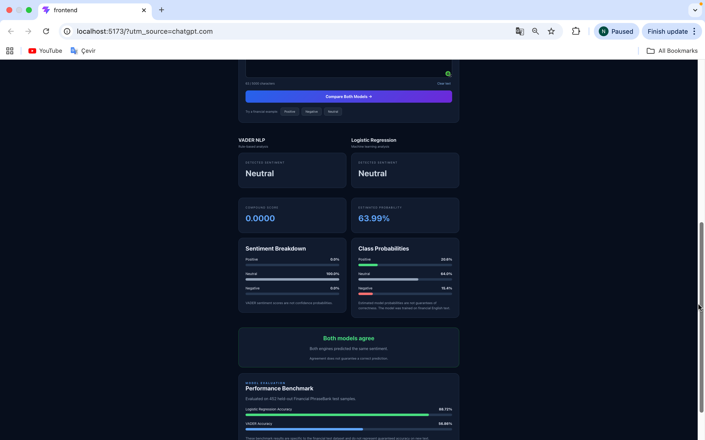
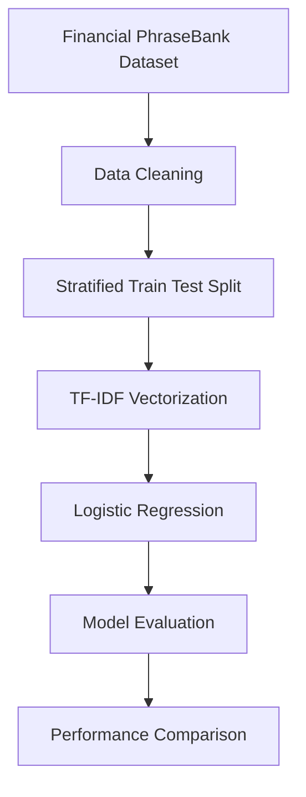
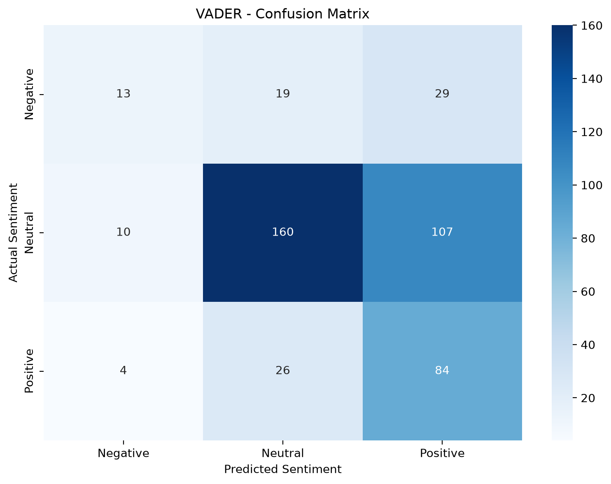

[](https://github.com/oraln21/SentimentIQ/actions/workflows/ci.yml)


<h1 align="center">🧠 SentimentIQ</h1>

<h3 align="center">
Intelligent Sentiment Analysis Platform
</h3>

<p align="center">
Transforming text into meaningful insights.
</p>

<p align="center">
  
  
  
  
</p>

---

## Overview

SentimentIQ is a natural language processing platform designed to analyse English text and classify sentiment as positive, negative or neutral.

The project combines sentiment analysis, REST API development and automated software testing to demonstrate practical software engineering and artificial intelligence concepts.

---


## Application Showcase

SentimentIQ combines rule-based Natural Language Processing
and a custom-trained Machine Learning model in an interactive
analytics dashboard.

### Positive Sentiment Analysis


### Negative Sentiment Analysis


### Neutral Sentiment Analysis



The dashboard enables users to compare VADER NLP and
Logistic Regression predictions, explore sentiment scores
and identify agreement or disagreement between both models.

---

### Neutral Sentiment Analysis

Neutral statements are analysed and classified based on
their compound sentiment score.


### Dashboard Features

- Real-time sentiment analysis
- Interactive text input
- Positive, negative and neutral classification
- Visual sentiment breakdown
- Compound sentiment scoring
- Character counter and input validation
- Responsive dark-themed interface
- Frontend and backend API integration

---


## Current Features

- English text sentiment analysis
- Positive, negative and neutral classification
- Compound sentiment scoring
- RESTful API using FastAPI
- Interactive Swagger API documentation
- Input validation and error handling
- Automated unit and API testing

## Technology Stack

<p>
  
</p>

| Technology | Purpose |
| --- | --- |
| Python | Core programming language |
| VADER | Rule-based sentiment analysis |
| FastAPI | REST API development |
| Uvicorn | Application server |
| Pytest | Automated testing |
| HTTPX | API testing |

## System Architecture

```mermaid
flowchart TD
    A[User Input] --> B[FastAPI REST API]
    B --> C[Input Validation]
    C --> D[VADER Sentiment Engine]
    D --> E[Sentiment Classification]
    E --> F[JSON Response]
    For a detailed explanation of the system architecture,
machine learning pipeline, API design and testing strategy,
see the [System Architecture Documentation](docs/architecture.md).
```

## Project Structure

```text
SentimentIQ/
├── backend/
│   ├── __init__.py
│   ├── main.py
│   └── sentiment.py
├── tests/
│   └── test_sentiment.py
├── requirements.txt
├── .gitignore
├── LICENSE
└── README.md
```

## Installation

Clone the repository:

```bash
git clone https://github.com/oraln21/SentimentIQ.git
cd SentimentIQ
```

Create a virtual environment:

```bash
python3 -m venv .venv
source .venv/bin/activate
```

Install the dependencies:

```bash
python -m pip install -r requirements.txt
```

## Running the Application

```bash
python -m uvicorn backend.main:app --reload --port 8001
```

Open the interactive API documentation:

http://127.0.0.1:8001/docs


## Docker Deployment

SentimentIQ supports containerised deployment using a
multi-stage Docker build that combines the React frontend
and FastAPI backend into a single application image.

### Build the Docker Image

```bash
docker build -t sentimentiq:1.1 .
```

### Run the Application

```bash
docker run -d \
  --name sentimentiq-demo \
  -p 127.0.0.1:8003:8000 \
  sentimentiq:1.1
```

Open the application:

- Dashboard: http://localhost:8003/app/
- API documentation: http://localhost:8003/docs
- Health endpoint: http://localhost:8003/health

### Run with a Locally Trained Model

If a compatible trained model is available in the local
models directory, it can be mounted as a read-only volume.

```bash
docker run -d \
  --name sentimentiq-ml \
  -p 127.0.0.1:8005:8000 \
  -v "$(pwd)/models:/app/models:ro" \
  sentimentiq:1.1
```

The dataset and trained model are excluded from the
public repository and Docker image pending verification
of their distribution conditions.

Without the trained model, VADER remains available.
Machine learning and comparison endpoints return a
controlled HTTP 503 response.

### Deployment Features

- Multi-stage Docker build
- Single-server frontend and backend integration
- Non-root application user
- Automated container health checks
- Pinned core machine learning dependencies
- Read-only local model mounting
- Graceful handling of unavailable models

---


## API Endpoints

| Method | Endpoint | Description |
| --- | --- | --- |
| GET | / | Application information |
| GET | /health | Health check |
| POST | /analyze | Analyse text sentiment |

### Example Request

```json
{
  "text": "I absolutely love this product!"
}
```

### Example Response

```json
{
  "text": "I absolutely love this product!",
  "sentiment": "Positive",
  "scores": {
    "positive": 0.545,
    "neutral": 0.455,
    "negative": 0.0,
    "compound": 0.6989
  }
}
```

## Automated Testing

Run the test suite:

```bash
python -m pytest -v
```

Initial local test results:

- 10 tests passed
- 0 tests failed
- 1 dependency deprecation warning

---

## Machine Learning Model

SentimentIQ includes a custom-trained supervised
machine learning model using TF-IDF feature extraction
and Logistic Regression.

The model is benchmarked against the VADER rule-based
sentiment analysis engine.

### Dataset

- Dataset: Financial PhraseBank (sentences_allagree)
- Total cleaned records: 2,259
- Training samples: 1,807
- Testing samples: 452
- Training/testing split: 80/20
- Classification: Positive, Negative and Neutral
- Random seed: 42

### Machine Learning Pipeline



### Model Performance

Both approaches were evaluated using the same
held-out test dataset.

| Metric | Logistic Regression | VADER |
| --- | ---: | ---: |
| Accuracy | 88.72% | 56.86% |
| Macro Precision | 84.62% | 54.79% |
| Macro Recall | 85.56% | 50.92% |
| Macro F1-score | 85.08% | 48.74% |

The custom-trained model achieved an accuracy
improvement of approximately 31.86 percentage
points over the VADER baseline on this dataset.

### Performance Comparison


### Logistic Regression Confusion Matrix


### VADER Confusion Matrix



### Reproducing the Experiment

```bash
python ml/prepare_data.py
python ml/train_model.py
python -m ml.evaluate_model
```

### Research Limitations

- The dataset focuses on financial English text.
- Results may not generalise to other text domains.
- Class imbalance is addressed using balanced
  class weights.
- Further evaluation on independent datasets is needed.
- Dataset and trained model files are excluded from
  the public repository due to licensing considerations.
- The trained model is not yet integrated into the
  web application.

---


## Limitations

- Currently designed for English text.
- VADER uses a rule-based approach.
- Sentiment scores are not calibrated confidence probabilities.
- Sarcasm and complex contextual meaning may reduce accuracy.


## Development Roadmap

- [x] Project architecture
- [x] VADER sentiment analysis engine
- [x] FastAPI backend
- [x] Input validation
- [x] Automated backend testing
- [x] Dataset preparation
- [x] Custom machine learning model training
- [x] Model performance evaluation
- [x] React and TypeScript frontend
- [x] Dual engine integration
- [x] Model comparison dashboard
- [x] Playwright browser testing
- [x] GitHub Actions continuous integration
- [x] System architecture documentation
- [ ] Final documentation and repository cleanup
- [ ] Public application deployment
- [ ] Live demonstration
- [ ] Cross-domain model evaluation
- [ ] Batch sentiment analysis
- [ ] Advanced model explainability

## Author

**Nilay Oral**

Software Engineering Student | AI & Machine Learning

[GitHub Profile](https://github.com/oraln21)

## License

This project is licensed under the MIT License.

---

<p align="center">
  Built with curiosity, code and continuous learning.
</p>
