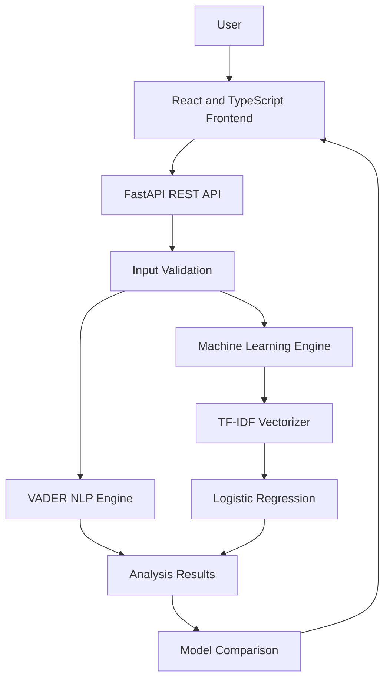
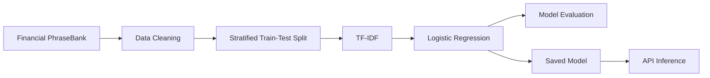
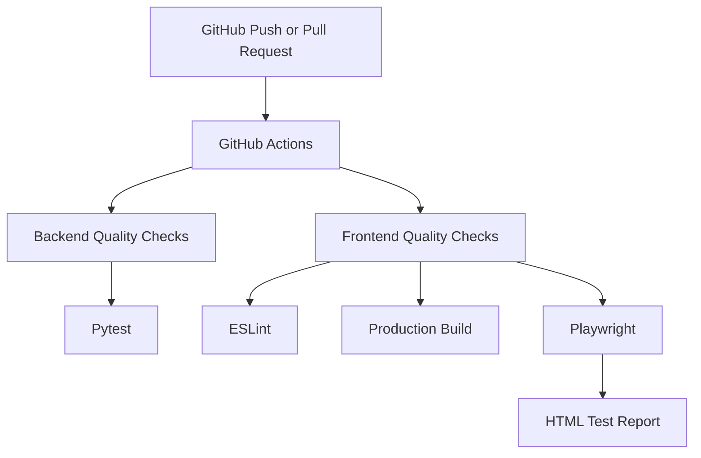

# SentimentIQ — System Architecture

## 1. System Overview

SentimentIQ is a full-stack sentiment analysis application
that combines rule-based natural language processing with
a custom-trained supervised machine learning model.

The application supports individual sentiment analysis
and side-by-side model comparison.

## 2. High-Level Architecture

## 3. Technology Stack

| Layer | Technology |
| --- | --- |
| Frontend | React, TypeScript, CSS |
| Build Tool | Vite |
| Backend | Python, FastAPI |
| API Server | Uvicorn |
| Input Validation | Pydantic |
| NLP Engine | VADER |
| Machine Learning | Scikit-learn |
| Feature Extraction | TF-IDF |
| Classification | Logistic Regression |
| Data Processing | Pandas, NumPy |
| Model Persistence | Joblib |
| Backend Testing | Pytest |
| Browser Testing | Playwright |
| Continuous Integration | GitHub Actions |
| Version Control | Git and GitHub |

## 4. API Architecture

| Method | Endpoint | Purpose |
| --- | --- | --- |
| GET | / | Application information |
| GET | /health | Backend health check |
| POST | /analyze | VADER sentiment analysis |
| POST | /analyze/ml | Machine learning analysis |
| POST | /analyze/compare | Compare both models |

## 5. Machine Learning Pipeline

### Dataset

- Financial PhraseBank
- 2,259 cleaned records
- 1,807 training samples
- 452 testing samples
- Positive, Negative and Neutral classes
- Random seed: 42

### Model Evaluation

| Metric | Logistic Regression | VADER |
| --- | ---: | ---: |
| Accuracy | 88.72% | 56.86% |
| Macro Precision | 84.62% | 54.79% |
| Macro Recall | 85.56% | 50.92% |
| Macro F1-score | 85.08% | 48.74% |

These results are specific to the held-out financial
sentiment dataset and should not be interpreted as
guaranteed accuracy on unseen domains.

## 6. Testing Architecture

### Local Testing Results

- 20 backend tests passed.
- 12 Playwright browser tests passed.
- Frontend linting passed.
- Production build passed.

Browser tests use mocked API responses.

The trained model integration test is skipped in CI
when the local model artifact is unavailable.

## 7. Design Decisions

- Separate frontend and backend responsibilities.
- Use REST APIs for communication between components.
- Maintain independent sentiment analysis engines.
- Provide transparent model comparison.
- Validate user input before analysis.
- Exclude generated artifacts from version control.
- Use automated testing and pull request validation.

## 8. Limitations

- Designed for English-language text.
- The machine learning model was trained on financial text.
- Performance may decrease on other text domains.
- Sarcasm and complex context remain challenging.
- VADER scores are not confidence probabilities.
- Model agreement does not guarantee correctness.
- Estimated class probabilities are not necessarily calibrated.

## 9. Future Development

- Public application deployment.
- Expanded training datasets.
- Batch sentiment analysis.
- Improved model explainability.
- Additional accessibility testing.
- Cross-domain model evaluation.

## Author

Nilay Oral

Software Engineering | Artificial Intelligence |
Machine Learning
